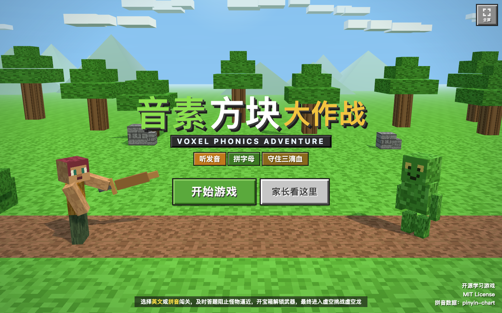

# 方块拼读大作战

Voxel Phonics Adventure

方块拼读大作战是一款可离线运行的体素学习游戏，包含英文自然拼读、汉语拼音和 100 以内数学三种模式。玩家通过拼词、选拼音或计算加减法击退靠近的怪物；通关后可开宝箱解锁武器，最后进入虚空挑战虚空龙。

游戏没有后端，不收集账号或学习数据。进度、星级和武器状态只保存在当前浏览器的 `localStorage` 中。



## 主要功能

- 英文自然拼读：短元音、辅音连缀、二合音、魔法 e、元音组合等 9 关
- 汉语拼音：基于 `pinyin-chart` 的 411 个标准普通话音节，拆分为声母、韵母和调号，共 10 关
- 100 以内数学：每场战斗随机生成一道加法或减法，使用屏幕数字小键盘填写答案；减法不出现负数
- 生存机制：答题过慢时怪物会攻击，三滴血耗尽后重新闯关
- 路线概览：每道题对应路线上的一个怪物节点，战斗胜利后角色会在地图上前进，再进入下一场战斗
- 成长机制：第一关使用木剑，整关路线完成后终点才出现宝箱；领取后自动装备第一件新武器，并继承到下一关
- 拼音朗读：汉字题卡出现时自动朗读一次汉字，再由孩子选择声母、韵母和声调
- 单轮题目去重，并优先抽取当前关卡尚未完成的题目
- 桌面和手机布局，支持触屏、数字键盘、键盘输入、系统语音与全屏
- 单文件发布，构建后的 `index.html` 可直接分享

## 直接运行

下载仓库中的 `index.html`，使用 Chrome、Edge 或 Safari 打开即可。游戏资源、题库、Three.js 和拼音数据均已嵌入文件，不需要联网加载其他资源。

系统朗读依赖浏览器可用的中英文语音。部分设备可能调用系统的在线语音服务，具体行为由浏览器和操作系统决定。

## 从源码构建

需要 Node.js 18 或更新版本，不需要安装第三方 npm 包。

```bash
npm run build
npm test
```

构建脚本会把 `data/pinyin-chart-syllables.json` 嵌入 `src/game.template.html`，生成根目录的 `index.html`。测试会检查内联脚本语法、拼音数据条数、构建占位符和公开版禁用标识。

需要生成对外分享文件时，使用专用导出命令：

```bash
npm run export:share -- --output-dir /path/to/output
```

导出脚本会扫描目标目录已有版本，自动生成下一个文件，例如 `方块拼读大作战_开源版_v14.html`；已有版本不会被覆盖。

## 目录结构

```text
.
├── index.html                         # 可直接分享的单文件游戏
├── src/game.template.html             # 游戏源码模板
├── data/pinyin-chart-syllables.json   # 拼音数据
├── scripts/build.mjs                  # 构建脚本
├── scripts/check.mjs                  # 静态检查
├── scripts/export-share.mjs           # 自动递增版本号的分享版导出脚本
├── third_party/                       # 第三方许可证
└── docs/                              # 截图
```

## 浏览器能力

- WebGL：渲染体素场景
- Web Audio：生成操作和战斗音效
- Speech Synthesis：朗读英文单词和拼音题卡中的汉字
- localStorage：保存本机学习进度

建议使用近两年的主流浏览器。设备不支持语音合成时，游戏仍可继续答题。

## 许可证

项目原创代码采用 [MIT License](LICENSE)。Three.js 和 `pinyin-chart` 的来源与许可见 [THIRD_PARTY_NOTICES.md](THIRD_PARTY_NOTICES.md)。

这是一个独立的开源教育游戏，不隶属于任何商业游戏品牌。
